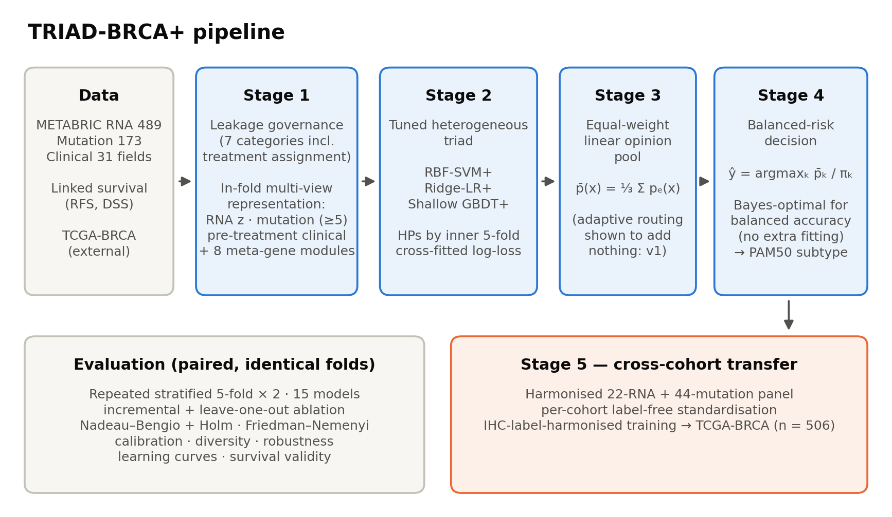

# TRIAD-BRCA+

**Knowledge-Guided Heterogeneous Ensembling with Balanced-Risk Decision Calibration for Leakage-Controlled PAM50 Breast Cancer Subtyping and Harmonised Cross-Cohort Transfer**

Himani Agrawal and Megha Rathi<br>
Department of CSE & IT, Jaypee Institute of Information Technology, Noida, India

[](https://doi.org/10.5281/zenodo.XXXXXXX)

Code, figures and tables accompanying the manuscript submitted to the *Journal of Computer Science & Technology*.

## Overview

Multi-omics PAM50 subtyping of breast cancer is often reported with balanced accuracies above 90%, figures that are sensitive to data leakage and evaluation artefacts. Our leakage-controlled predecessor, TRIAD-BRCA v1, found that adaptive multi-expert routing adds nothing over equal-weight averaging and that transfer to TCGA-BRCA collapses. TRIAD-BRCA+ keeps fusion deliberately simple and moves the modelling effort to the two ends of the pipeline:

1. **Stricter leakage governance**: receptor status, derived molecular labels, treatment-assignment variables and all histology encodings are excluded before modelling, and every preprocessing step is fitted inside the training fold.
2. **Knowledge-guided, full-panel multi-view representation**: the complete 489-gene RNA panel, a prevalence-filtered mutation view (≥ 5 carriers), a pre-treatment clinical view and eight label-free meta-gene modules (proliferation, luminal/ER, HER2-amplicon, basal/myoepithelial, immune, stromal and two biological axes).
3. **Tuned heterogeneous expert triad**: RBF-SVM, ridge multinomial logistic regression and shallow gradient-boosted trees, with hyper-parameters chosen by inner cross-fitted log-loss.
4. **Equal-weight linear opinion pool** of the three expert posteriors.
5. **Balanced-risk decision rule**: $\hat{y} = \arg\max_k \bar{p}_k / \pi_k$, which is Bayes-optimal for balanced accuracy and needs no additional fitting.
6. **Harmonised cross-cohort transfer**: label-free per-cohort standardisation and label-definition alignment for METABRIC → TCGA-BRCA.



*Figure 1. Architecture of TRIAD-BRCA+. Stages 1–4 are fitted strictly inside each outer training fold; Stage 5 transfers the framework to TCGA-BRCA.*

## Key results

Fifteen models (16 configurations) were compared on METABRIC (n = 1,559; four PAM50 subtypes) using repeated stratified 5-fold cross-validation (× 2) on identical folds, with Nadeau–Bengio corrected resampled t-tests (Holm-adjusted) and Friedman–Nemenyi ranking.

| Endpoint | TRIAD-BRCA v1 (re-run, same folds) | **TRIAD-BRCA+** (balanced-risk) | TRIAD-BRCA+ (arg-max) |
|---|---|---|---|
| METABRIC balanced accuracy | 0.831 ± 0.015 | **0.849 ± 0.019** | 0.843 ± 0.026 |
| METABRIC macro-F1 | 0.840 ± 0.016 | 0.844 ± 0.021 | 0.852 ± 0.025 |
| METABRIC MCC | 0.777 ± 0.020 | 0.780 ± 0.031 | 0.791 ± 0.035 |
| METABRIC macro-AUC | 0.970 ± 0.007 | 0.972 ± 0.006 | 0.972 ± 0.006 |
| METABRIC accuracy | 0.847 ± 0.014 | 0.846 ± 0.022 | 0.857 ± 0.024 |
| TCGA-BRCA transfer balanced accuracy | 0.616 | **0.695** | — |
| TCGA-BRCA transfer MCC | 0.369 | 0.510 | — |

*Mean ± SD over 10 paired folds (Table 22). TCGA rows compare the v1 protocol (E1) with the proposed harmonised protocol (E3).*

- TRIAD-BRCA+ ranked first of all 16 configurations (Friedman p = 3.9 × 10⁻¹⁶) and beat TRIAD-BRCA v1 in all ten folds (+1.76 percentage points balanced accuracy, Holm-adjusted p = 0.042) without loss of accuracy.
- It raised HER2-enriched recall from 0.759 to 0.836 and gave the best-calibrated posteriors (Brier score 0.202).
- Ablation attributed the gains to removing the univariate feature bottleneck and to the decision rule, not to stacking or adaptive routing.
- The leakage audit showed that reporting accuracy instead of balanced accuracy inflates performance by 1–2 percentage points, whereas re-inserting receptor status changes balanced accuracy by less than one point.
- Harmonised transfer raised TCGA-BRCA balanced accuracy from 0.616 to 0.695 and MCC from 0.369 to 0.510, and predicted subtypes stratified disease-specific survival as strongly as the reference labels (log-rank χ² 92.1 vs 91.9).

## Repository structure

```
├── README.md
├── CITATION.cff                          citation metadata (used by GitHub and Zenodo)
└── TRIAD-BRCA-plus/
    ├── TRIAD-BRCA-plus_Colab.ipynb       complete pipeline: data loading, cross-validation, leakage audit,
    │                                     learning curves, external transfer, all tables and figures
    ├── Figures/                          Figure_1.png … Figure_17.png (300 dpi) with captions
    ├── Tables/                           Table_1.csv … Table_24.csv, All_Tables.xlsx, with captions
    ├── data/README.md                    where to download the five input files
    └── requirements.txt
```

Figures and tables are numbered exactly as in the manuscript; captions are listed in [Figures/README.md](TRIAD-BRCA-plus/Figures/README.md) and [Tables/README.md](TRIAD-BRCA-plus/Tables/README.md).

## Data

All inputs are public and are **not redistributed** in this repository. Download them from their sources (manuscript references [86]–[90]) as described in [data/README.md](TRIAD-BRCA-plus/data/README.md):

| Ref. | File | Source |
|---|---|---|
| [86] | METABRIC_RNA_Mutation | https://www.kaggle.com/datasets/raghadalharbi/breast-cancer-gene-expression-profiles-metabric |
| [87] | Breast_Cancer_METABRIC | https://www.kaggle.com/datasets/gunesevitan/breast-cancer-metabric |
| [88] | brca_metabric_clinical_data | https://www.cbioportal.org/study/summary?id=brca_metabric |
| [89] | brca_data_w_subtypes_tcga | https://www.kaggle.com/datasets/samdemharter/brca-multiomics-tcga |
| [90] | clinical_-_clinical_tcga | https://portal.gdc.cancer.gov/projects/TCGA-BRCA |

The analytical cohort comprises the four reproducible PAM50 subtypes in METABRIC: Basal-like (n = 199), HER2-enriched (n = 220), Luminal A (n = 679) and Luminal B (n = 461). Claudin-low, Normal-like and unclassified tumours are excluded as a disclosed scope restriction. The external cohort is TCGA-BRCA (n = 506) with immunohistochemistry-surrogate labels.

## Reproducing the results

**Google Colab (as used for the paper)**

1. Open `TRIAD-BRCA-plus/TRIAD-BRCA-plus_Colab.ipynb` in Colab; a CPU runtime is enough.
2. Select *Run all* and upload the five CSV files when asked. Alternatively, set `USE_GOOGLE_DRIVE = True` in the first cell and put the files in `MyDrive/TRIAD-BRCA-plus/data`.
3. Tables, figures, an Excel workbook of all tables and a zip of the results are written to `results/`.

**Locally**

```bash
cd TRIAD-BRCA-plus
pip install -r requirements.txt
mkdir -p data && cp /path/to/the/five/*.csv data/
jupyter notebook TRIAD-BRCA-plus_Colab.ipynb
```

A single seed (42) controls all randomness and BLAS/OpenMP thread pools are fixed to one thread. Set `QUICK = True` in the first cell for a fast reduced run (3-fold × 1; numbers will differ from the paper). The saved run in the notebook took about 100 minutes on a 2-core Colab CPU runtime.

## Citation

If you use this code, figures or tables, please cite:

> H. Agrawal and M. Rathi. TRIAD-BRCA+: Knowledge-Guided Heterogeneous Ensembling with Balanced-Risk Decision Calibration for Leakage-Controlled PAM50 Breast Cancer Subtyping and Harmonised Cross-Cohort Transfer. *Journal of Computer Science & Technology* (submitted).

```bibtex
@article{agrawal_rathi_triadbrcaplus,
  author  = {Agrawal, Himani and Rathi, Megha},
  title   = {{TRIAD-BRCA+}: Knowledge-Guided Heterogeneous Ensembling with Balanced-Risk Decision Calibration for Leakage-Controlled {PAM50} Breast Cancer Subtyping and Harmonised Cross-Cohort Transfer},
  journal = {Journal of Computer Science \& Technology},
  note    = {Submitted}
}
```

## Contact

- Himani Agrawal — agrawal.himani1010@gmail.com
- Megha Rathi — megha.rathi@mail.jiit.ac.in
